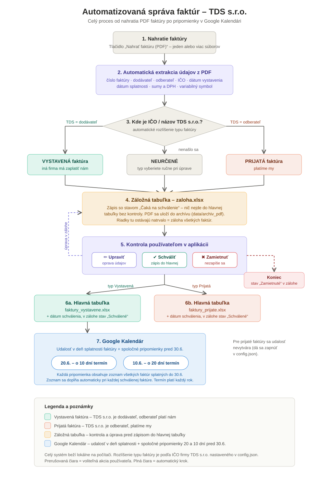

# Invoice Processing Automation (TDS s.r.o.)

A desktop application that turns PDF invoices into structured accounting
data. It reads each invoice, extracts the key fields, classifies it as
**received** (a supplier bill we pay) or **issued** (an invoice a client
pays us), writes it into Excel ledgers after a human review step, and
schedules payment reminders in Google Calendar.

It was built for and is used in production at **TDS s.r.o.**, a Slovak HVAC
and ventilation company. It replaces manual retyping of invoice data.

> **Privacy by design:** everything runs locally. Invoice text never leaves
> the machine. The only external call is creating the calendar events.



## The problem

Received invoices come from many different suppliers, each with its own layout.
Some are digital PDFs, some are scans, and some have corrupted embedded text:
the invoice looks fine on screen, but the text layer is missing digits or
has broken font encoding. A single template or a single regex can't handle
that.

## How it works: a layered extraction pipeline

Each layer only runs for the fields the previous layers couldn't fill, so
most invoices are processed in seconds and the slow fallbacks are rare.

1. **Text extraction:** `pdfplumber` for digital PDFs, with automatic
   **Tesseract OCR** (Slovak + English) as a fallback for scanned pages.
2. **Rule-based parsing:** dozens of targeted extractors for invoice number,
   supplier/customer, company IDs (IČO), dates, totals, VAT breakdown and
   payment reference. They handle tables, inline amounts, labels split
   across lines, and VAT derived from the gross amount.
3. **Validation:** company IDs are checked and auto-corrected with their
   **check-digit algorithm**. Invoice direction (received vs issued) comes
   from where the company's own ID and name appear.
4. **Local LLM fill-in:** missing fields are requested from a local model
   through **Ollama** (`llama3.1:8b`), with retries. AI output is
   normalised and validated before it's accepted.
5. **AI cross-check:** the LLM re-reads amounts found by regex on its own.
   If the two disagree, the record is flagged for the reviewer instead of
   letting an error through silently.
6. **Vision rescue:** for the few invoices with a corrupted text layer, a
   **vision-language model** (`qwen2.5vl:7b`) reads the amounts straight
   from the rendered page image, the way a human would.

## Human-in-the-loop workflow

```
PDF upload ─► extraction ─► staging sheet ("pending") ─► review in GUI
                                                         │ edit / approve / reject
                                                         ▼
                              received.xlsx / issued.xlsx  +  Google Calendar
```

- Every record goes to a **staging workbook** first and is only written to
  the main ledgers after a person approves it. The staging copy stays as a
  permanent audit trail, and every original PDF is archived.
- When an issued invoice is approved, the app creates an all-day calendar
  event on its **due date** and updates two rolling **summary reminders**
  (20 and 10 days before the yearly deadline). Each reminder lists every
  issued invoice that's due.

## Tech stack

Python · pdfplumber · Tesseract OCR (pytesseract) · Ollama (Llama 3.1,
Qwen2.5-VL) · openpyxl · Google Calendar API (OAuth 2.0) · ttkbootstrap
(Tkinter GUI) · PowerShell installer

## Project structure

| File | Responsibility |
|---|---|
| `app.py` | GUI: upload, review table, edit/approve/reject |
| `extractor.py` | Extraction pipeline: text/OCR, rule-based parsing, validation, LLM and vision fallbacks |
| `excel_manager.py` | Staging and main Excel ledgers |
| `calendar_manager.py` | Google Calendar events and rolling reminders |
| `config.json` | Company ID, reminder schedule, AI/OCR switches |
| `instalacia.ps1` | One-click setup on a new machine (dependencies, Tesseract, desktop shortcut) |
| `NAVOD.md` | End-user manual (Slovak) |

## Running it

```bash
pip install -r requirements.txt
python app.py
```

Optional features:

- **OCR:** install Tesseract (`instalacia.ps1` does this on Windows).
- **Local AI:** install [Ollama](https://ollama.com), then run
  `ollama pull llama3.1:8b`. For the vision fallback, also run
  `ollama pull qwen2.5vl:7b`.
- **Calendar:** put a Google OAuth `credentials.json` next to `app.py`.
  The first approval opens a browser to sign in.

If Ollama, Tesseract or Google credentials are missing, the app skips that
step and still works. Full setup steps for the end user are in
[`NAVOD.md`](NAVOD.md) (Slovak).

## Data handling

Real invoices, generated ledgers and Google credentials are excluded via
`.gitignore`. This repository has no customer data in it.
