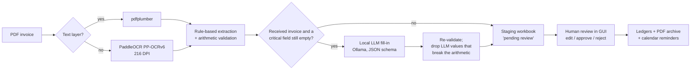

# Invoice processing automation — TDS s.r.o.

[](https://github.com/ProksaDominik/tdsfakture/actions/workflows/ci.yml)


A desktop application that turns PDF invoices into accounting records. It reads
each invoice, extracts the key fields, decides whether it is **received** (a
supplier bill) or **issued** (the company's own invoice), and — after a person
has reviewed it — writes it to the Excel ledgers, archives the PDF and
schedules payment reminders in Google Calendar.

It is used in production at **TDS s.r.o.**, a Slovak HVAC and ventilation
company, where it replaced manual retyping of invoices. Everything runs locally:
invoice text never leaves the company network.

The repository also contains a companion app, [`timesheets/`](timesheets/),
which reads handwritten monthly timesheets and writes the hours to the
payroll workbook.

## The problem

Received invoices come from dozens of suppliers, each with its own layout.
Some are digital PDFs, most arrive as scans, and some have a broken text layer
(the page looks fine, but the embedded text is missing digits). Fields move
around, labels wrap across lines, two-column layouts get merged into one line
by the PDF reader, and OCR turns `IČO:` into `ICO;`. One template — or one
regex — cannot cover that.

## How it works



1. **Text.** `pdfplumber` reads digital PDFs; pages with no usable text are
   rendered at 216 DPI and read with PaddleOCR (PP-OCRv6 medium detection and
   multilingual recognition, which covers Slovak diacritics). OCR returns loose
   text boxes, so they are regrouped into lines by vertical position and read
   left to right, with a wide gap kept as a column break: labels and values end
   up on one line, the same shape the rules get from a PDF text layer. It runs
   on an NVIDIA GPU when one is present.
2. **Rules.** Targeted extractors find the invoice number, supplier and
   customer, company IDs (IČO), issue/supply/due dates, net amount, VAT, total
   and payment reference. They handle labels wrapped onto the next line, values
   that the PDF reader moved far from their label, several amounts merged into
   one line, `§69` reverse-charge references that look like thousands, and
   common OCR misreads of separators.
3. **Validation.** Net + VAT must equal the total (±0.02 €); a missing amount
   is derived only when the other two are known; the implied VAT rate must be
   realistic (0–45 %); dates more than three years from today are rejected as
   OCR misreads. Values that fail are cleared rather than guessed, so the
   reviewer sees an empty field instead of a plausible wrong one.
4. **Classification.** Direction comes from the company's own ERP template
   (issued invoices carry fixed phrases) and from where the company's IČO and
   name appear. Domestic vs foreign comes from the VAT-ID country prefix — not
   the text language, because international platforms localise their invoices
   into Slovak.
5. **LLM fill-in.** Only for *received* invoices, and only for the critical
   fields the rules left empty, a local model (Gemma 4, `gemma4:e4b-it-qat`
   via Ollama, with thinking switched off) is asked for the missing values
   with a JSON-schema-constrained response. Its answers pass the same validation; if they break the
   arithmetic, the rule-based values are restored.
6. **Human in the loop.** Every record lands in a staging workbook first and
   reaches the ledgers only after approval. The staging copy is kept as an
   audit trail; approved PDFs are filed in the archive, received invoices
   under the company's internal archive number (DF/zDF).

### Design decisions worth knowing

- **Rules first, LLM for the gaps.** On the office CPU one call to the earlier
  3B model took 30–60 s, while the rules finish in milliseconds and are deterministic. The
  LLM is skipped entirely when the rules already filled every critical field.
- **The LLM never overrides the rules.** An earlier version asked the LLM to
  re-read every invoice and cross-check the regex values. In practice the
  earlier 3B model occasionally swapped the net amount and the total, and the
  "cross-check" destroyed correct values, so it was removed.
- **Thinking is switched off.** Gemma 4 reasons before answering by default;
  the hidden reasoning used up the whole response-token cap, the JSON answer
  came back empty and the fill-in silently found nothing. Every call now sends
  `think=false` (models that do not support the flag are called without it).
- **A vision-model fallback was tried and removed.** Reading amounts from the
  rendered page with a VLM rescued a few invoices with corrupted text layers,
  but was too slow on office hardware to justify.
- **Empty beats wrong.** In a review workflow a missing value costs the
  reviewer a few seconds; a wrong value that looks right can slip into the
  ledger. Validation therefore prefers clearing a field to keeping a doubtful
  one.

## Evaluation

[`evaluation/`](evaluation/) measures the extractor on real invoices by
re-running it on archived PDFs and comparing the output with ground truth from
one of two sources:

- **Values a person approved in the app** (staging workbook or an Invoice Desk
  database) — every reviewable field.
- **Payment QR codes and archive file names** — no manual labelling.
  Slovak invoices carry a PAY by square code and Czech ones a QR Platba code,
  generated by the issuer's accounting system from the invoice data; the
  extractor never reads them. They give the amount to pay and the variable
  symbol. Archive file names add the direction (received invoices are filed
  under the internal number assigned on approval) and, for issued invoices,
  the invoice number. Documents with two different payment codes, or an
  issued invoice whose QR variable symbol differs from its file name, get no
  labels from that source. The QR amount is the amount *to pay*: on an
  invoice with a retention or a deducted advance it differs from the total, so
  such invoices count as misses for the total.

  The QR code's date is **not** used, although it is meant to be the due date.
  The first scored run put due-date accuracy at 7 %, so the labels were checked
  before the extractor: on 220 of 242 issued invoices the QR date is exactly
  14, 30 or 60 days (the payment terms) before the printed due date — the
  invoicing system writes the issue date there — and suppliers differ.

```bash
python -m evaluation --pdfs <archived PDFs> --zaloha <staging workbook>      # approved values
python -m evaluation.payment_qr --pdfs <PDFs> --out labels_qr.csv             # QR + file-name labels
python -m evaluation --pdfs <PDFs> --labels labels_qr.csv                     # ... scored with them
python -m evaluation.rescore --run <run> --labels <fixed.csv> --out <dir>     # re-score saved predictions
python -m evaluation --pdfs <PDFs> --llm gemma4:e4b-it-qat                    # + LLM setup
python -m evaluation --pdfs <PDFs>                                            # fill rate + speed only
```

It reports per-field accuracy (= recall), precision and F1, the same pooled
over all fields, the share of invoices with every field correct, and time per
stage (text layer, OCR, parsing, LLM). Only fields a reviewer can actually edit
in the app are scored; fields that are stored but never shown for review would
just compare the extractor with itself. The report contains aggregates only;
per-invoice output stays in the gitignored `eval_results/` folder.

### Results

437 real office documents (2026) with ground truth from payment QR codes and
archive file names; 160 digital, 277 scanned. Laptop with an RTX 5050 (8 GB).

| Field | Documents | Rules: accuracy / precision | Rules + Gemma 4: accuracy / precision |
|---|---:|---:|---:|
| Direction (received / issued) | 422 | 99.5 % / 99.5 % | 99.5 % / 99.5 % |
| Invoice number (issued) | 238 | 100 % / 100 % | 100 % / 100 % |
| Amount to pay | 352 | 90.3 % / 98.5 % | **96.3 %** / 98.5 % |
| Variable symbol | 352 | 85.2 % / 100 % | 85.2 % / 100 % |
| **All fields pooled** | 1,364 | 93.5 % / 99.5 % (F1 96.4 %) | **95.1 % / 99.5 % (F1 97.2 %)** |
| Every field right | 437 | 356 (81.5 %) | 376 (86.0 %) |

- **Misses are mostly empty fields, not wrong values** — precision stays at
  99.5 %. The variable symbol is never wrong, but it is missing on 52 invoices,
  44 of them received ones, 31 of those digital: the rules do not recognise
  some suppliers' layouts. This is the gap the trained model closes (below).
- Of the 5 totals counted as wrong, the QR amount is 50 %, 9.5 % or 60 % of
  the extracted total — consistent with advance and retention invoices, where
  the amount to pay legitimately differs from the total.
- Gemma 4 was called on 132 of 437 documents (median 2.4 s per call).
- Speed per document (median): 0.15 s for a digital PDF, 11.6 s for a scanned
  one (median 3 pages, ~3.5 s per page with PaddleOCR on the GPU). On a CPU
  without CUDA PaddleOCR took 56–100 s per page, so the office PC needs an
  NVIDIA GPU for scans.

## Trained models

Two models trained from the same office documents, split into train /
validation / test by **supplier** (303 / 46 / 96 documents from 153 / 21 / 62
supplier groups — QR IBAN, else IČO or name), so every test number is on
suppliers the model never saw. Code in [`training/`](training/), everything
reproducible from [`notebooks/pipeline.ipynb`](notebooks/pipeline.ipynb).

### Extraction: LiLT fine-tuned on QR-labelled invoices

[LiLT](https://huggingface.co/nielsr/lilt-xlm-roberta-base) (XLM-RoBERTa base,
MIT licence) reads each word with its position on the page, from the PDF text
layer or PaddleOCR word boxes. Training labels are automatic: words that read
as the QR amount or variable symbol are tagged; 227 of 228 training invoices
matched. 20 epochs, 42 minutes on the laptop GPU.

Test split, 82 invoices with QR ground truth:

| | Accuracy | Precision | F1 | Every field right |
|---|---:|---:|---:|---:|
| Rules | 91.5 % | 99.3 % | 95.2 % | 68 |
| Rules + Gemma 4 (current app) | 92.1 % | 99.3 % | 95.6 % | 69 |
| LiLT alone | 95.7 % | 97.5 % | 96.6 % | 76 |
| **Rules, then LiLT for empty fields** | **98.8 %** | **99.4 %** | **99.1 %** | **80** |

On the 13 received invoices the rules find the variable symbol 3 times, LiLT
12 times. LiLT alone picks a wrong total more often than the rules (4 vs 1), so
it belongs where the LLM is today: filling fields the rules left empty, never
overriding them. In that role it fills 10 of the 11 variable symbols the rules
missed; Gemma 4 fills none. *Limits:* 82 test invoices (13 received), two
scored fields, and the combination is scored on saved predictions — it is not
wired into the app yet.

### OCR: a CRNN text recognizer trained from scratch

CNN → two-layer BiLSTM → CTC, 8.5 M parameters, no pretrained weights. Trained
on synthetic invoice lines (generated field patterns, 30 fonts, scan-like
degradation that keeps diacritics readable) mixed 70 / 30 with 5,314 real lines
cut from digital invoices of training suppliers, whose text layer gives an exact
transcription. 2,000 + 15,000 steps; the 15,000 took 56 minutes on the laptop
GPU.

Test: 1,386 real lines from test-split suppliers; PaddleOCR's recognizer (the
app's model) scored on exactly the same crops:

| | CER | CER, spaces ignored | Lines exact, spaces ignored |
|---|---:|---:|---:|
| **Own CRNN** | **1.8 %** | **1.8 %** | **90.4 %** |
| PaddleOCR PP-OCRv6 (pretrained) | 7.5 % | 2.9 % | 75.2 % |

Spaces are reported separately because a PDF text layer and an OCR engine space
words differently. *Limits:* these are clean renderings of digital invoices —
the kind of line the CRNN was trained on — and only recognition is compared;
the app still uses PaddleOCR, which also finds the text lines on scanned pages.

### What the measurements caught

- **The QR date is not the due date.** The first scored run put due-date
  accuracy at 7 %. The labels were checked before the extractor: on 220 of 242
  issued invoices the QR date is the issue date. The field was dropped.
- **A barcode drawn with a font.** One invoice's Aztec code has a text layer of
  random letters; its 324 "lines" were 73 % of the first OCR test errors (CER
  5.8 % → 1.8 % once barcode fonts are skipped).
- **Gemma 4 thinks before answering.** The hidden reasoning used up the token
  budget and the JSON answer came back empty; calls now switch thinking off.
- **Laptop GPU limits.** Batches that overflowed the 8 GB were spilled to
  system RAM by Windows (0.17 → 2.8 training steps per second after the fix),
  and cuDNN's LSTM dropout made every finished run abort on exit.

## Tests

`pytest` runs 164 tests in about two seconds — no PDFs, OCR or LLM needed. The
PDF reader is stubbed and the pipeline runs on synthetic invoice texts
(received, issued, foreign reverse-charge). The tests cover the parsing rules,
the arithmetic validation, the LLM gate (never called without config or for
issued invoices; only asked for missing critical fields; a fill-in that breaks
net + VAT = total is discarded), regrouping OCR text boxes into lines, the
Ollama call (thinking off), the ledger helpers, the timesheet payroll writer,
the evaluation metrics, re-scoring, the payment-QR decoder that produces
ground truth, and the training data pipeline (charset and CTC decoding,
synthetic lines, word labels, the supplier split). CI runs ruff and the tests
on Windows and Linux, Python 3.10 and 3.12.

**Known limitations** (each one is a test or an evaluation case):

- An inline `Customer s.r.o., IČO: 12345678` layout keeps the `IČO` suffix in
  the party name (documented by a strict `xfail` test).
- Company names without a Slovak/Czech legal form (e.g. `… Ireland Limited`)
  are often not found by the rules and are filled in by the reviewer.
- Company IDs are validated by format only; the check-digit validation of
  earlier versions is not part of the current pipeline.

## Running it

Windows (the production platform):

```powershell
powershell -ExecutionPolicy Bypass -File scripts\install.ps1   # deps, PaddlePaddle (GPU/CPU), config.json, shortcut
```

Manually, on any OS:

```bash
python -m venv .venv && .venv/Scripts/activate    # or: source .venv/bin/activate
pip install -r requirements.txt
cp config.example.json config.json                # then set ico_firmy and file paths
python app.py
```

Optional components — the app skips a step if its component is missing:

| Component | Setup |
|---|---|
| OCR for scans | [PaddleOCR](https://github.com/PaddlePaddle/PaddleOCR) is in `requirements.txt`; its engine is installed separately: `pip install paddlepaddle` (CPU), or `paddlepaddle-gpu` from the [PaddlePaddle index](https://www.paddlepaddle.org.cn/en/install/quick) for an NVIDIA GPU. Models (~135 MB) download on the first scan. |
| LLM fill-in | [Ollama](https://ollama.com), then `ollama pull gemma4:e4b-it-qat` (6.1 GB) |
| Calendar reminders | Google OAuth `credentials.json` next to `app.py` (see the user guide, §2.4) |

Development:

```bash
pip install -r requirements-dev.txt
pytest
ruff check .
```

## Configuration

`config.json` is machine-specific and not versioned; start from
[`config.example.json`](config.example.json).

| Key | Meaning |
|---|---|
| `ico_firmy`, `varianty_nazvu` | Company ID and name variants — used to tell received from issued invoices |
| `ic_dph_firmy` | Own VAT number — never reported as the counterparty's (OCR misreads of it included) |
| `subor_prijate`, `subor_vystavene`, `subor_zaloha` | Ledger workbooks and the staging workbook |
| `priecinok_invoices` | Inbox folder with scanned invoices |
| `priecinok_faktury`, `priecinok_faktury_pre_skladnikov` | Archive for approved PDFs and the warehouse copy |
| `archivacia_tuzemske_od`, `archivacia_zahranicne_od` | Starting points of the internal archive numbering |
| `ollama_zapnute`, `ollama_model`, `ollama_pokusy` | LLM fill-in switch, model and retries |
| `kalendar_zapnuty`, `hromadny_termin`, `hromadne_pripomienky_dni` | Calendar reminders |

## Repository layout

| Path | Contents |
|---|---|
| `app.py` | GUI: upload, review table, edit / approve / reject |
| `extractor.py` | Extraction pipeline: text and OCR, rules, validation, LLM fill-in |
| `excel_manager.py` | Staging workbook, ledgers, archive numbering and PDF filing |
| `calendar_manager.py` | Google Calendar due-date and summary reminders |
| `evaluation/` | Accuracy and speed measurement against approved invoices or payment-QR ground truth |
| `training/` | Own models: CRNN text recognizer (`ocr/`), LiLT extraction (`extraction/`), supplier split |
| `notebooks/pipeline.ipynb` | The whole measurement and training pipeline, step by step, with charts |
| `tests/` | Unit and pipeline tests on synthetic data |
| `timesheets/` | Companion app for handwritten timesheets |
| `docs/user-guide-sk.md` | End-user manual (Slovak) |
| `scripts/install.ps1` | One-click setup on a new Windows PC |

Identifiers and comments in the code are in Slovak, the language of the
people who use and maintain the app; this README and the tests are in English.

## Data handling

The repository contains no customer data. Invoices, ledgers, machine
configuration and credentials are gitignored, and the tests use made-up
invoices. Apart from creating calendar events, nothing is sent to external
services; the LLM runs locally through Ollama.

## License

[MIT](LICENSE)
