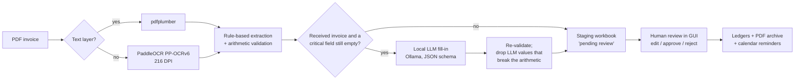

# Invoice processing automation — TDS s.r.o.

[](https://github.com/ProksaDominik/tdsfakture/actions/workflows/ci.yml)


A desktop application that turns PDF invoices into accounting records. It reads
each invoice, extracts the key fields, decides whether it is **received** (a
supplier bill) or **issued** (the company's own invoice), and — after a person
has reviewed it — writes it to the Excel ledgers, archives the PDF and
schedules payment reminders in Google Calendar.

It is used in production at **TDS s.r.o.**, a Slovak HVAC and ventilation
company, where it replaced manual retyping of invoices. Everything runs locally:
invoice text never leaves the company network.

The repository also contains a companion app, [`timesheets/`](timesheets/),
which reads handwritten monthly timesheets and writes the hours to the
payroll workbook.

## The problem

Received invoices come from dozens of suppliers, each with its own layout.
Some are digital PDFs, most arrive as scans, and some have a broken text layer
(the page looks fine, but the embedded text is missing digits). Fields move
around, labels wrap across lines, two-column layouts get merged into one line
by the PDF reader, and OCR turns `IČO:` into `ICO;`. One template — or one
regex — cannot cover that.

## How it works



1. **Text.** `pdfplumber` reads digital PDFs; pages with no usable text are
   rendered at 216 DPI and read with PaddleOCR (PP-OCRv6 medium detection and
   multilingual recognition, which covers Slovak diacritics). OCR returns loose
   text boxes, so they are regrouped into lines by vertical position and read
   left to right, with a wide gap kept as a column break: labels and values end
   up on one line, the same shape the rules get from a PDF text layer. It runs
   on an NVIDIA GPU when one is present.
2. **Rules.** Targeted extractors find the invoice number, supplier and
   customer, company IDs (IČO), issue/supply/due dates, net amount, VAT, total
   and payment reference. They handle labels wrapped onto the next line, values
   that the PDF reader moved far from their label, several amounts merged into
   one line, `§69` reverse-charge references that look like thousands, and
   common OCR misreads of separators.
3. **Validation.** Net + VAT must equal the total (±0.02 €); a missing amount
   is derived only when the other two are known; the implied VAT rate must be
   realistic (0–45 %); dates more than three years from today are rejected as
   OCR misreads. Values that fail are cleared rather than guessed, so the
   reviewer sees an empty field instead of a plausible wrong one.
4. **Classification.** Direction comes from the company's own ERP template
   (issued invoices carry fixed phrases) and from where the company's IČO and
   name appear. Domestic vs foreign comes from the VAT-ID country prefix — not
   the text language, because international platforms localise their invoices
   into Slovak.
5. **LLM fill-in.** Only for *received* invoices, and only for the critical
   fields the rules left empty, a local model (`qwen2.5:3b-instruct` via
   Ollama) is asked for the missing values with a JSON-schema-constrained
   response. Its answers pass the same validation; if they break the
   arithmetic, the rule-based values are restored.
6. **Human in the loop.** Every record lands in a staging workbook first and
   reaches the ledgers only after approval. The staging copy is kept as an
   audit trail; approved PDFs are filed in the archive, received invoices
   under the company's internal archive number (DF/zDF).

### Design decisions worth knowing

- **Rules first, LLM for the gaps.** On the office CPU one LLM call takes
  30–60 s, while the rules finish in milliseconds and are deterministic. The
  LLM is skipped entirely when the rules already filled every critical field.
- **The LLM never overrides the rules.** An earlier version asked the LLM to
  re-read every invoice and cross-check the regex values. In practice the 3B
  model occasionally swapped the net amount and the total, and the
  "cross-check" destroyed correct values, so it was removed.
- **A vision-model fallback was tried and removed.** Reading amounts from the
  rendered page with a VLM rescued a few invoices with corrupted text layers,
  but was too slow on office hardware to justify.
- **Empty beats wrong.** In a review workflow a missing value costs the
  reviewer a few seconds; a wrong value that looks right can slip into the
  ledger. Validation therefore prefers clearing a field to keeping a doubtful
  one.

## Evaluation

[`evaluation/`](evaluation/) measures the extractor on real invoices by
re-running it on archived PDFs and comparing the output with the values a
person approved in the app:

```bash
python -m evaluation --pdfs <archived PDFs> --zaloha <staging workbook>      # accuracy
python -m evaluation --pdfs <PDFs> --llm qwen2.5:3b-instruct                 # + LLM setup
python -m evaluation --pdfs <PDFs>                                            # fill rate + speed only
```

It reports per-field accuracy (= recall), precision and F1, the same pooled
over all fields, the share of invoices with every field correct, and time per
stage (text layer, OCR, parsing, LLM). Only fields a reviewer can actually edit
in the app are scored; fields that are stored but never shown for review would
just compare the extractor with itself. The report contains aggregates only;
per-invoice output stays in the gitignored `eval_results/` folder.

Results on approved production invoices will be published in this section
once the baseline run is complete.

## Tests

`pytest` runs 107 tests in about a second — no PDFs, OCR or LLM needed. The
PDF reader is stubbed and the pipeline runs on synthetic invoice texts
(received, issued, foreign reverse-charge). The tests cover the parsing rules,
the arithmetic validation, the LLM gate (never called without config or for
issued invoices; only asked for missing critical fields; a fill-in that breaks
net + VAT = total is discarded), the ledger helpers, the timesheet payroll
writer and the evaluation metrics. CI runs ruff and the tests on Windows and
Linux, Python 3.10 and 3.12.

**Known limitations** (each one is a test or an evaluation case):

- An inline `Customer s.r.o., IČO: 12345678` layout keeps the `IČO` suffix in
  the party name (documented by a strict `xfail` test).
- Company names without a Slovak/Czech legal form (e.g. `… Ireland Limited`)
  are often not found by the rules and are filled in by the reviewer.
- Company IDs are validated by format only; the check-digit validation of
  earlier versions is not part of the current pipeline.

## Running it

Windows (the production platform):

```powershell
powershell -ExecutionPolicy Bypass -File scripts\install.ps1   # deps, PaddlePaddle (GPU/CPU), config.json, shortcut
```

Manually, on any OS:

```bash
python -m venv .venv && .venv/Scripts/activate    # or: source .venv/bin/activate
pip install -r requirements.txt
cp config.example.json config.json                # then set ico_firmy and file paths
python app.py
```

Optional components — the app skips a step if its component is missing:

| Component | Setup |
|---|---|
| OCR for scans | [PaddleOCR](https://github.com/PaddlePaddle/PaddleOCR) is in `requirements.txt`; its engine is installed separately: `pip install paddlepaddle` (CPU), or `paddlepaddle-gpu` from the [PaddlePaddle index](https://www.paddlepaddle.org.cn/en/install/quick) for an NVIDIA GPU. Models (~135 MB) download on the first scan. |
| LLM fill-in | [Ollama](https://ollama.com), then `ollama pull qwen2.5:3b-instruct` |
| Calendar reminders | Google OAuth `credentials.json` next to `app.py` (see the user guide, §2.4) |

Development:

```bash
pip install -r requirements-dev.txt
pytest
ruff check .
```

## Configuration

`config.json` is machine-specific and not versioned; start from
[`config.example.json`](config.example.json).

| Key | Meaning |
|---|---|
| `ico_firmy`, `varianty_nazvu` | Company ID and name variants — used to tell received from issued invoices |
| `subor_prijate`, `subor_vystavene`, `subor_zaloha` | Ledger workbooks and the staging workbook |
| `priecinok_invoices` | Inbox folder with scanned invoices |
| `priecinok_faktury`, `priecinok_faktury_pre_skladnikov` | Archive for approved PDFs and the warehouse copy |
| `archivacia_tuzemske_od`, `archivacia_zahranicne_od` | Starting points of the internal archive numbering |
| `ollama_zapnute`, `ollama_model`, `ollama_pokusy` | LLM fill-in switch, model and retries |
| `kalendar_zapnuty`, `hromadny_termin`, `hromadne_pripomienky_dni` | Calendar reminders |

## Repository layout

| Path | Contents |
|---|---|
| `app.py` | GUI: upload, review table, edit / approve / reject |
| `extractor.py` | Extraction pipeline: text and OCR, rules, validation, LLM fill-in |
| `excel_manager.py` | Staging workbook, ledgers, archive numbering and PDF filing |
| `calendar_manager.py` | Google Calendar due-date and summary reminders |
| `evaluation/` | Accuracy and speed measurement against approved invoices |
| `tests/` | Unit and pipeline tests on synthetic data |
| `timesheets/` | Companion app for handwritten timesheets |
| `docs/user-guide-sk.md` | End-user manual (Slovak) |
| `scripts/install.ps1` | One-click setup on a new Windows PC |

Identifiers and comments in the code are in Slovak, the language of the
people who use and maintain the app; this README and the tests are in English.

## Data handling

The repository contains no customer data. Invoices, ledgers, machine
configuration and credentials are gitignored, and the tests use made-up
invoices. Apart from creating calendar events, nothing is sent to external
services; the LLM runs locally through Ollama.

## License

[MIT](LICENSE)
