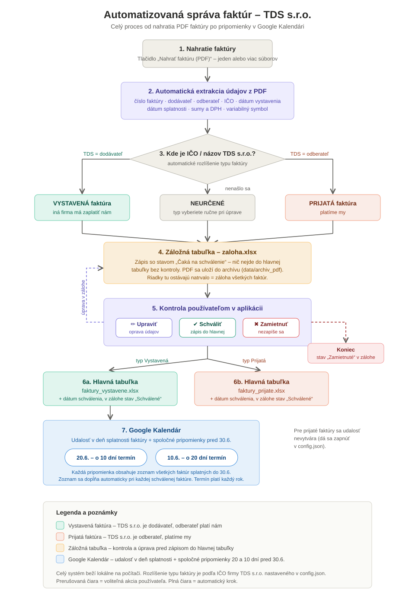

# Invoice management – TDS s.r.o.

*English version of [`user-guide-sk.md`](user-guide-sk.md), the guide the office
staff use. The app's buttons are in Slovak; their English meaning is given in
brackets.*

A local app that processes invoices automatically: it reads a PDF invoice,
tells whether it is **received** (we pay) or **issued** (we get paid), writes
the data to the Excel workbooks and creates Google Calendar events: one on each
invoice's due date, plus shared reminders **20 and 10 days before 30 June**
listing every invoice due by then.

Everything runs **locally on your computer**. No data is sent to outside
servers (apart from creating events in your own Google Calendar).



---

## 1. How it works

1. **Upload** – click "Nahrať faktúru (PDF)" (upload invoice) and choose one or
   more PDF files.
2. **Extraction** – the app reads the invoice number, supplier, customer, company
   IDs (IČO), issue and due dates, amounts, VAT and variable symbol. For
   **received** invoices (every supplier has its own template) the rules run
   first; fields they cannot find are filled in by a local AI model (Ollama, see
   2.5) running on your own computer, so no invoice text leaves it.
3. **Type** – decided by where TDS s.r.o.'s IČO or name appears:
   - TDS is the **supplier** → **issued** invoice (another company pays us),
   - TDS is the **customer** → **received** invoice (we pay),
   - if it cannot be decided → type "Neurčené" (undetermined); choose it by hand
     via "Upraviť" (edit).
4. **Staging workbook** – the data is FIRST written to `data/zaloha.xlsx` with the
   status "Čaká na schválenie" (pending approval), and the PDF is copied to
   `data/archiv_pdf`.
5. **Review** – check the record in the app:
   - **Upraviť** (edit) – correct misread values,
   - **Schváliť** (approve) – the record is written to the main workbook,
   - **Zamietnuť** (reject) – the record never reaches the main workbook.
6. **Main workbooks** – after approval the row is added to:
   - `data/faktury_prijate.xlsx` – received invoices,
   - `data/faktury_vystavene.xlsx` – issued invoices.
   The row stays in staging (status "Schválené", approved) as a permanent backup.
7. **Google Calendar** – when an issued invoice is approved:
   - an all-day event is created on the invoice's **due date**,
   - the two **shared reminders 20 and 10 days before 30 June** (10 and 20 June)
     are updated; each lists ALL issued invoices due by the next 30 June. Every
     approved invoice is added to the list automatically, and the 30 June
     deadline repeats every year.
   Notifications come from Google Calendar (phone and computer).

---

## 2. Installation (once)

### 2.1 Python

1. Download Python 3.10+ from <https://www.python.org/downloads/>.
2. During installation, **tick "Add Python to PATH"**.

### 2.2 Packages

Open a command prompt (cmd) in the app's folder and run:

```
pip install -r requirements.txt
```

### 2.3 Company settings – IMPORTANT

The settings are in `config.json`. It is not in git (it holds paths for one
particular computer); on the first installation `scripts/install.ps1` creates it
from `config.example.json`, or copy it by hand.

In `config.json`, fill in **TDS s.r.o.'s real company ID** (the example has
`12345678`):

```json
"ico_firmy": "YOUR_COMPANY_ID",
```

The app tells received and issued invoices apart by this ID, so it must be
right. Other options in `config.json`:

| Key | Meaning |
|---|---|
| `ic_dph_firmy` | the company's own VAT number, never reported as the other party's |
| `subor_prijate`, `subor_vystavene`, `subor_zaloha` | paths to the main workbooks and the staging workbook |
| `priecinok_invoices` | folder with invoice scans to process |
| `priecinok_faktury`, `priecinok_faktury_pre_skladnikov` | archive of approved PDFs and copies for the warehouse |
| `hromadny_termin` | yearly due date for the shared reminders (default `30.06.`) |
| `hromadne_pripomienky_dni` | how many days before that date the shared reminders come (default 20 and 10) |
| `kalendar_len_vystavene` | `true` = events only for issued invoices; `false` = for received ones too |
| `kalendar_zapnuty` | `false` = switch the calendar off completely |

### 2.4 Google Calendar API (once, about 10 minutes)

1. Open <https://console.cloud.google.com/> and sign in with the Google account
   whose calendar should get the reminders.
2. Top left, **create a new project** (e.g. "TDS Faktury").
3. In **APIs & Services → Library**, search for **Google Calendar API** and click
   **Enable**.
4. **APIs & Services → OAuth consent screen**:
   - type **External**, fill in the app name and your e-mail,
   - under **Test users**, add your Google e-mail.
5. **APIs & Services → Credentials → Create Credentials → OAuth client ID**:
   - application type: **Desktop app**,
   - download the JSON and save it as **`credentials.json`** in the app's folder
     (next to `app.py`).
6. When you approve the first invoice, a browser opens: sign in and allow access.
   `token.json` is created and from then on everything runs automatically,
   without signing in again.

### 2.5 AI fill-in of missing data (Ollama, optional)

Received invoices from different suppliers have no common template, so the rules
sometimes miss some fields. The app can then use a local AI model through
**Ollama**, a free tool that runs on your own computer (no data leaves it, and
it works offline).

1. Download and install Ollama from <https://ollama.com/download>.
2. Download the model (once, in a command prompt):
   ```
   ollama pull gemma4:e4b-it-qat
   ```
3. Ollama runs as a background service automatically after installation or a
   restart. The app connects to it by itself; nothing else needs setting up.

The fill-in can be controlled in `config.json`:

| Key | Meaning |
|---|---|
| `ollama_zapnute` | `false` = switch the AI fill-in off completely (rules only) |
| `ollama_model` | which model to use (default `gemma4:e4b-it-qat`, Gemma 4, 6.1 GB) |
| `ollama_pokusy` | how many times to ask the AI again for fields still missing (1 in the example config; a higher value helps when a small model finds a field only on the 2nd or 3rd try, but slows processing down) |

If Ollama is not running or the model is not downloaded, the app quietly skips
the fill-in and uses only what the rules found. Nothing breaks.

---

## 2.6 Moving to another computer

1. Copy **the whole app folder** (including `data/`, `config.json`, `assets/` and
   `credentials.json`/`token.json` if they exist) to the new computer, e.g. via a
   USB stick, OneDrive or a shared drive. The `__pycache__` folder does not need
   copying (it is recreated).
2. On the new computer, run **`scripts/install.ps1`** (right-click → "Run with
   PowerShell"). The script:
   - installs the Python packages from `requirements.txt`,
   - installs PaddlePaddle for OCR (reading scanned invoices): the GPU build with
     an NVIDIA graphics card, otherwise the CPU build; the OCR models (~135 MB)
     download automatically on the first scanned invoice,
   - creates a **"Sprava faktur TDS"** shortcut on the desktop with the app icon.
3. If Python is not installed yet, the script says so: install it as in 2.1 and
   run the script again.
4. If you use Google Calendar and copied `credentials.json` too, a browser opens
   for sign-in when you approve the first invoice on the new computer (a new
   `token.json` is created automatically).

---

## 3. Daily use

1. Click the **"Sprava faktur TDS"** shortcut on the desktop (created by
   `scripts/install.ps1`), or double-click `start.bat` (or run `python app.py`).
2. **Nahrať faktúru (PDF)** (upload invoice) → choose the invoices.
3. Check the rows in the table and, if needed, **Upraviť** (edit).
4. **Schváliť** (approve) → written to the main workbook + calendar event.

---

## 4. Files

| File / folder | Purpose |
|---|---|
| `app.py` | the main app (window) |
| `extractor.py` | reading data from PDFs |
| `excel_manager.py` | writing to the Excel workbooks |
| `calendar_manager.py` | Google Calendar |
| `config.json` | settings (company ID, reminders, ...) |
| `data/zaloha.xlsx` | staging workbook (review before approval) |
| `data/faktury_prijate.xlsx` | main workbook – received invoices |
| `data/faktury_vystavene.xlsx` | main workbook – issued invoices |
| `data/archiv_pdf/` | copies of all uploaded PDFs |
| `credentials.json` | Google API access (created as in 2.4) |
| `token.json` | saved sign-in (created automatically) |
| `assets/icon.png`, `assets/icon.ico` | app icon (window, desktop shortcut) |
| `scripts/install.ps1` | automatic installation on a new computer |
| `docs/workflow-sk.svg` | diagram of the whole process (above) |

---

## 5. Troubleshooting

**"Neurčené" (undetermined) as the invoice type** – neither TDS's company ID nor
its name was found in the PDF. Check `ico_firmy` in `config.json`; choose the
type by hand via "Upraviť".

**Empty fields after upload** – the invoice has an unusual layout. Scanned (or
printed and rescanned) invoices are read with OCR (PaddleOCR, automatically),
but with an unusual layout recognition can be inaccurate: fill the data in via
"Upraviť".

**Calendar failed** – check that `credentials.json` is in the app's folder and
that your e-mail is listed under Test users (2.4). If the Google account changed,
delete `token.json` and approve an invoice again.

**The Excel file cannot be saved** – close it in Excel; the app cannot write to
it while it is open.
